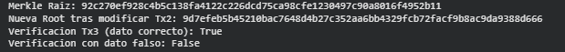

# Laboratorio 2 — Árbol de Merkle

## Laboratorio

- Cada hoja contiene el hash SHA-256 de un bloque de datos
- Cada nodo interno contiene el hash SHA-256 de la concatenación de sus dos hijos
- Si el número de hojas o ramas es impar, la última se duplica
- La raíz (Merkle Root) es el hash que representa todo el conjunto

- Crear 5 transacciones de datos (pueden ser transacciones simuladas)
- Construir el árbol y mostrar la raíz
- Modificar una transacción y demostrar que la raíz cambia
- Generar una prueba de inclusión para la transacción 3 y verificar que es válida
- verificar con un dato incorrecto → debe fallar

## Archivos

- `arbol_merkle.py`: código 
- `diagrama_arbol.txt`: diagrama del árbol

## Cómo ejecutar

```bash
python3 arbol_merkle.py
```

## Funciones

- `calcular_hash(texto)`: SHA-256 de un texto.
- `construir_arbol(transacciones)`: arma todos los niveles del árbol, de hojas a raíz
- `generar_prueba_inclusion(niveles_del_arbol, indice_hoja)`: hashes "hermanos" necesarios para reconstruir la raíz desde una hoja
- `verificar_prueba_inclusion(transaccion, prueba_inclusion, raiz_esperada)`: reconstruye la raíz con la transacción y la prueba, y la compara

## Capturas 



## Nota
El código y el diagrama del árbol fueron hechos con ayuda de inteligencia artificial