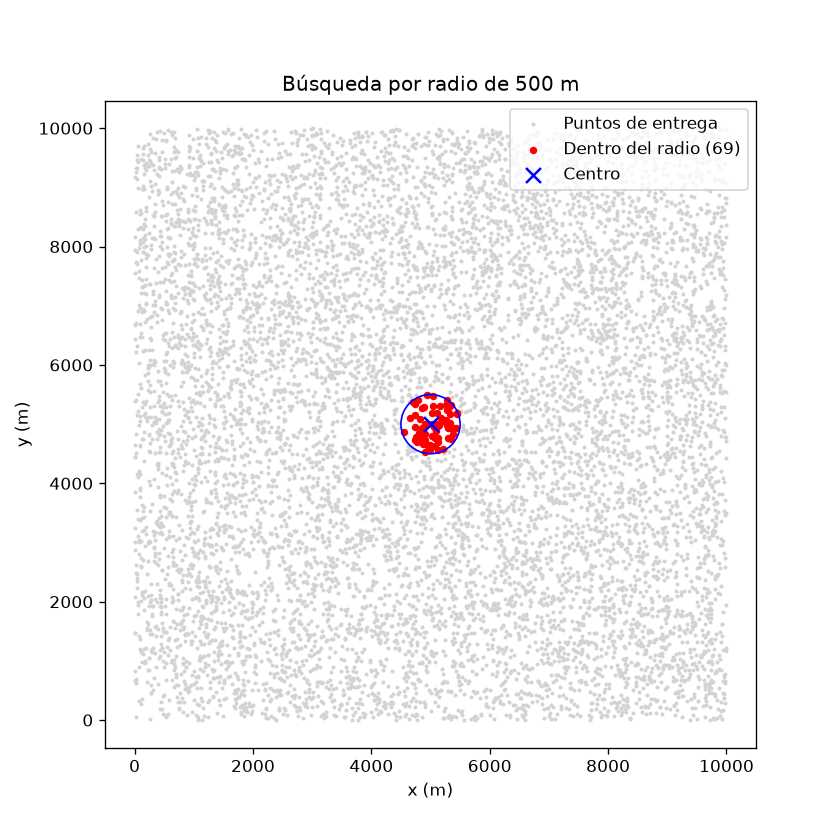
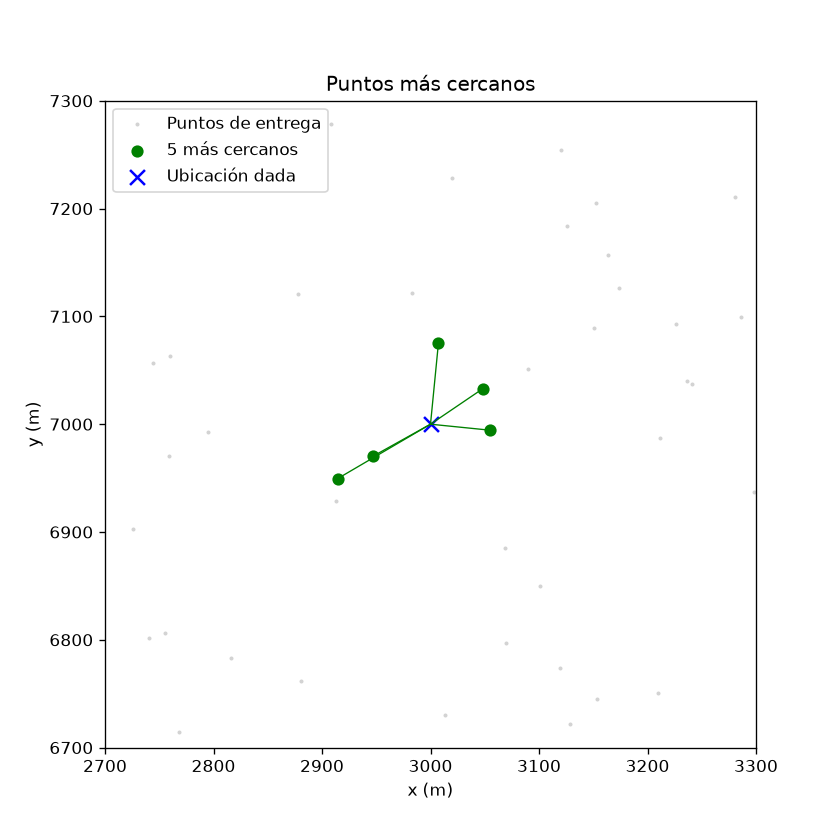
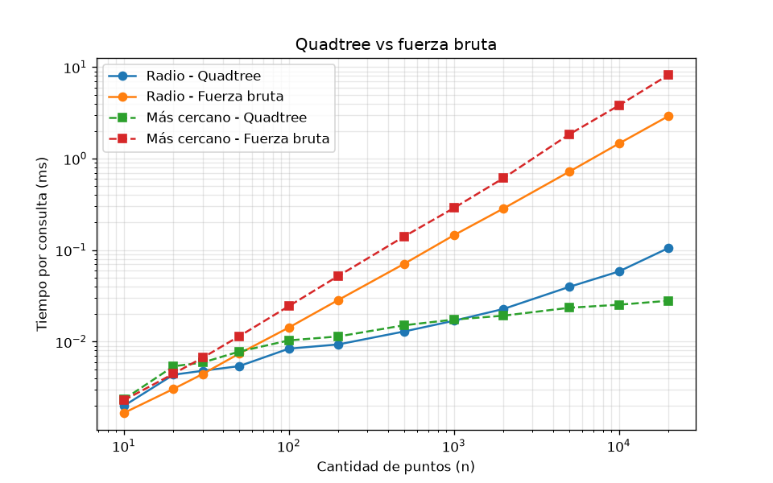
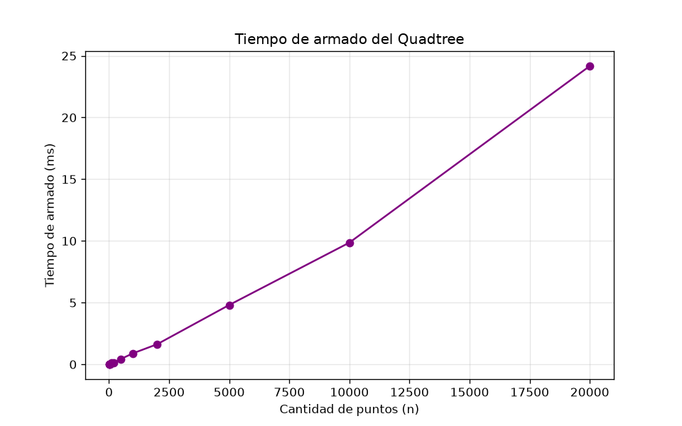

# Laboratorio 4 — Quadtree para puntos de entrega

## 1. Problema
Tenemos 10.000 puntos de entrega en una ciudad (coordenadas en metros) y queremos responder rápido dos cosas: qué puntos están a 500 m de un punto dado y cuál es el punto más cercano a una ubicación. Para eso hice un Quadtree desde cero y lo comparé con fuerza bruta (revisar todos los puntos uno por uno).

## 2. Contenido
```
Quadtree.py    # el Quadtree y la fuerza bruta
test.py        # pruebas unitarias y gráficas de verificación
analisis.py    # tiempos y discusión
```

## 3. Cómo correrlo
Instalar `pip install matplotlib` y, desde la carpeta de los archivos:
- `python test.py`: corre las pruebas y crea `radio.png` y `vecinos.png`
- `python analisis.py`: imprime los tiempos y crea `comparacion_tiempos.png` y `armado.png`

## 4. Resultados
Las 3 pruebas pasan: el Quadtree da lo mismo que fuerza bruta en 100 consultas de radio y 100 de más cercanos.

**Radio de 500 m** (centro en 5000, 5000)



Los puntos grises son las entregas, el círculo azul es el radio y los rojos son los que encontró el árbol: 69. Todos los rojos quedan dentro del círculo y ningún punto gris cae adentro.

**5 más cercanos** (ubicación en 3000, 7000)



La X azul es la ubicación y los verdes son los 5 más cercanos, unidos a la ubicación con una línea. Se ve que no hay ningún punto gris más cerca que los verdes.

**Tiempo por consulta (ms)**

| Consulta | Método | N=100 | N=1.000 | N=10.000 |
|---|---|---|---|---|
| Radio | Fuerza bruta | 0,015 | 0,138 | 1,392 |
| Radio | Quadtree | 0,008 | 0,018 | 0,058 |
| Más cercano | Fuerza bruta | 0,025 | 0,302 | 3,968 |
| Más cercano | Quadtree | 0,010 | 0,018 | 0,025 |




En el eje x está la cantidad de puntos y en el y el tiempo de una consulta (los dos en escala logarítmica). Las líneas de fuerza bruta suben casi igual que N, y las del Quadtree casi no suben. Con pocos puntos (menos de 30) da casi igual, y **desde unos 30 puntos el Quadtree empieza a ser más rápido**. Con 10.000 puntos es como 24 veces más rápido en radio y 156 veces en más cercano.

**Tiempo de armar el árbol**



Armar el árbol con 10.000 puntos tarda unos 10 ms (24 ms con 20.000). Como los puntos no cambian, se arma una sola vez y después se usa en todas las consultas.

## Nota
Usé inteligencia artificial como apoyo para hacer el código.
